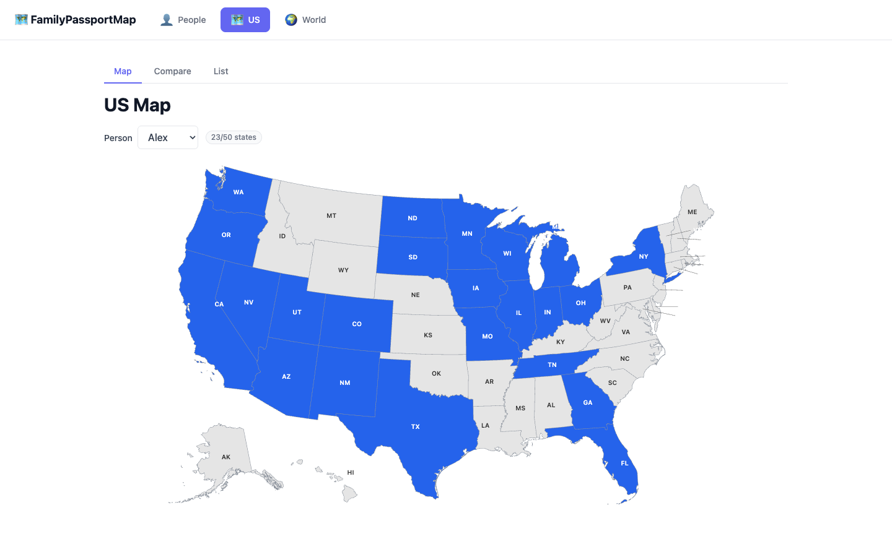
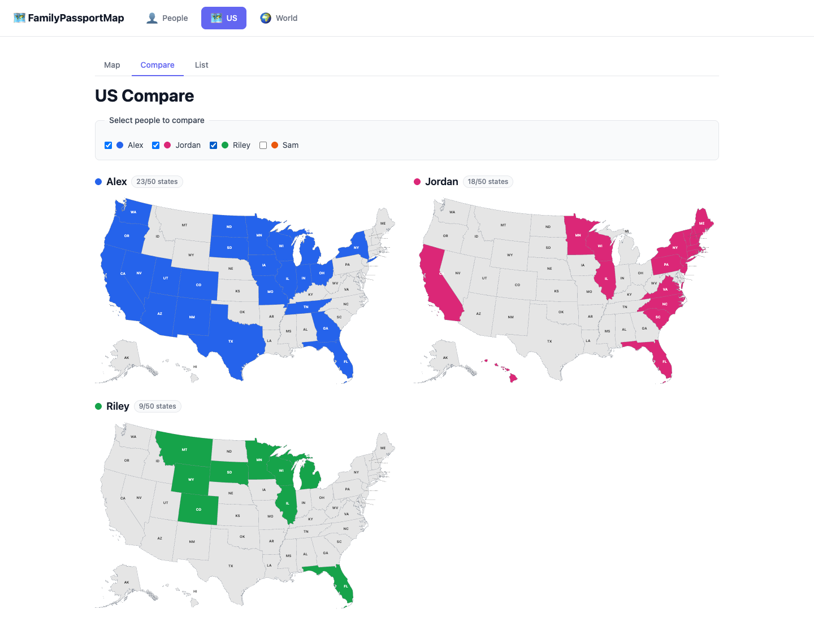
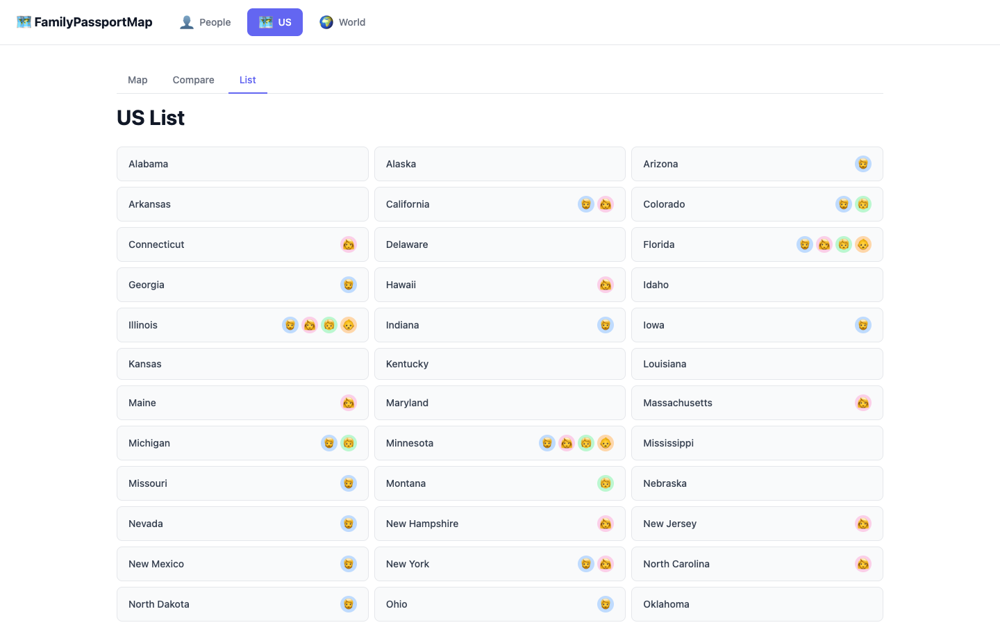
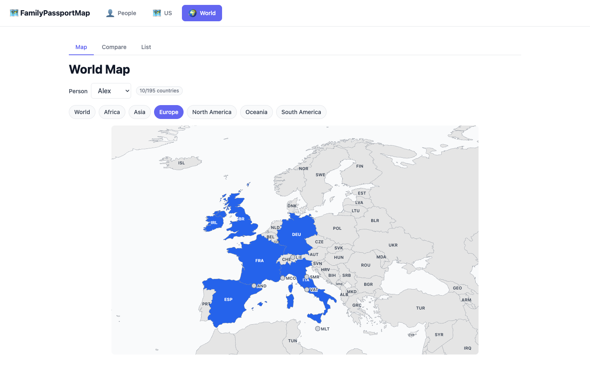
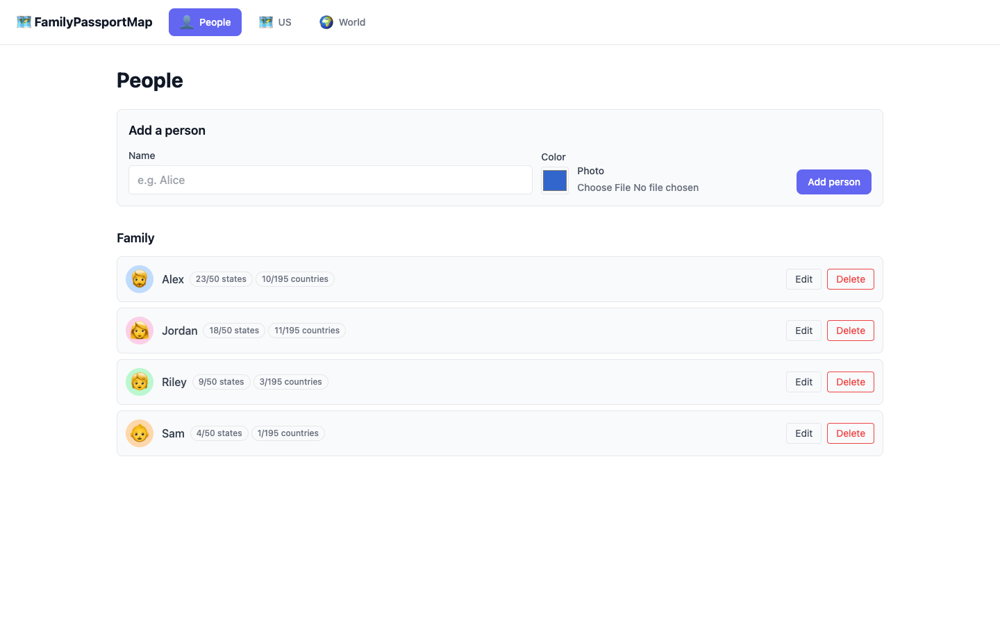
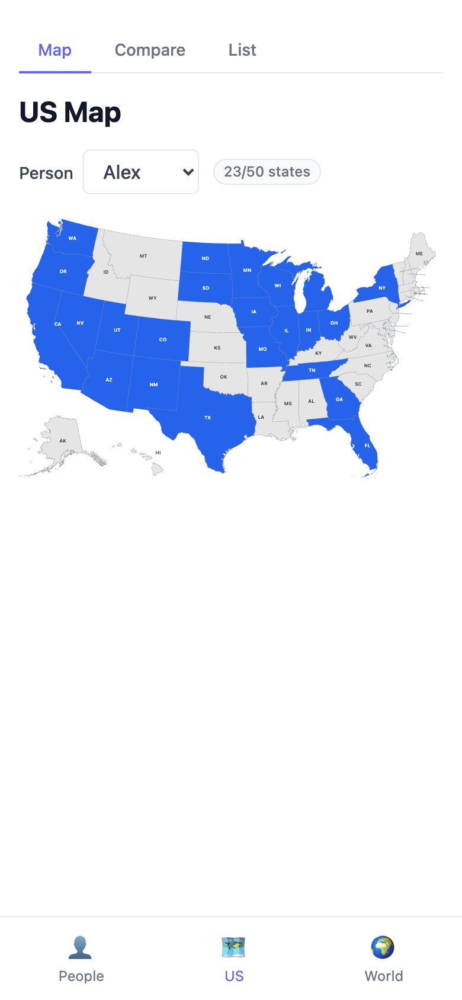

# FamilyPassportMap

FamilyPassportMap is a personal, family-friendly web app for tracking which places you and your family have visited — the 50 US states on a US map, and 195 countries on a world map you explore one continent at a time.

## Screenshots

*Shown with demo data (fictional family members).*

| Compare family members side by side | Every state, with who's been there |
|---|---|
|  |  |
| **World map, zoomed to one continent** | **People, with per-person counters** |
|  |  |

<em>The same app on a phone, with mobile bottom navigation.</em>

## What it does

- **Interactive US map** — click a state to mark it as visited.
- **Family members** — add people (a name, a chosen color, and an optional profile picture) and track each person's visited states independently.
- **Visited counters** — "n/50 states" and "n/195 countries" badges next to each person (People page, and the matching Map/Compare views).
- **Compare view** — see two or more family members' maps side by side.
- **List view** — see all 50 states in a list, with each visited person's profile-picture icon shown next to the states they've been to.
- **World section** — a separate 🌍 World area for tracking countries (195: the UN member and observer states). Its **World Map** zooms to one continent at a time for marking countries (each country is labeled with its three-letter code, and tiny countries like Vatican City or Tuvalu get a clickable dot), **World Compare** shows people's world maps side by side on a shared continent view, and **World List** groups every country by continent. Country and state tracking are fully independent.
- **Installable PWA** — works and looks right on phone, tablet, and desktop, and can be installed like a native app.
- **Private accounts** — sign in with your Google account. You see and manage only the People you added: nobody else can see them, their maps or their photos. Photos are shrunk to small avatars and served only to you.

### Accounts

- **Signing in:** anyone with a Google account can sign up. Signed out, you can see only the sign-in page and a short privacy page (`/privacy`) explaining what's stored.
- **"You":** on your first sign-in, a short welcome step adds you as your first Person (your name and a color). It's marked **You** on the People page and can't be deleted on its own. If you'd already added yourself as an ordinary Person, use **Set as me** on that Person. It becomes "You", and any states and countries on your old "You" are merged into it.
- **Up to 10 People** per account, yourself included.
- **Deleting your account:** **Delete account** in the account menu (your avatar, top right) permanently deletes your account and everything in it: your People, their visits and their photos. Signing in again starts fresh.

## How to use it

1. Sign in with Google, then pick your name and color on the welcome step.
2. On **People**, add any family members you want to track, each with a name, a color, and (optionally) a profile picture.
3. Open **US** from the top menu, pick a person on the **Map** tab, and click states to mark them visited — the state fills in with that person's color.
4. Switch to the **Compare** tab to see two or more people's maps side by side.
5. Switch to the **List** tab to see every state at a glance, with icons showing who's visited each one.
6. Open **World** to do the same for countries, using the same Map / Compare / List tabs: pick a continent, then click countries to mark them. Switching between US and World keeps you on the same tab.

## Tech stack

- **Frontend:** React + TypeScript (Vite), Tailwind CSS, installable as a PWA
- **Backend:** Node.js + TypeScript (Express), with Google sign-in and server-side sessions
- **Database:** SQLite via Prisma
- **Hosting:** Azure App Service (free tier)

## Project structure & docs

- [`PHASES.md`](PHASES.md) — the phased build plan from initial setup through v1.0.0 (US states), v2.0.0 (countries/world map) and v2.3.0 (login and accounts), with version numbers per phase
- [`CONTEXT.md`](CONTEXT.md) and [`docs/adr/`](docs/adr/) — the domain glossary (User, Person, Owner, Primary Person…) and the architecture decisions behind them
- [`Documentation/`](Documentation/) — one self-contained design spec per phase
- [`CHANGELOG.md`](CHANGELOG.md) — what shipped in each version
- `.claude/CLAUDE.md` — local, gitignored working instructions for Claude Code when developing this repo
- `DevNotes/` — local, gitignored working notes and logs (not part of the shipped app)

## Roadmap

v1.0.0 shipped the US-states feature set; v2.0.0 added countries on a world map (Phases 8–11); v2.3.0 added Google sign-in and private accounts (Phase 12). Next up is **Link** and **Join**, so households can see, or share in managing, each other's People. Blended/overlap coloring in Compare is still deliberately deferred. See [`PHASES.md`](PHASES.md).
